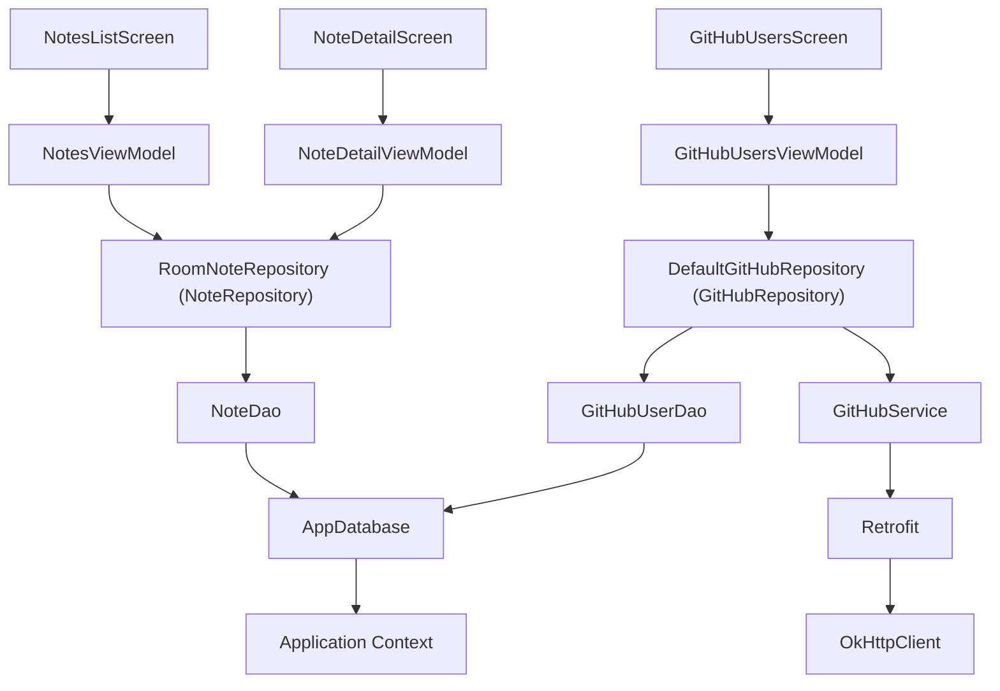
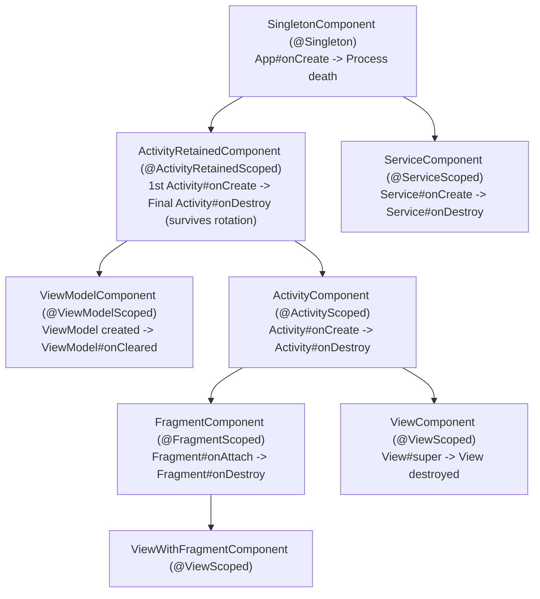

# Dependency Injection with Hilt — Practice Notes (Lecture 22)

> Complete record of theoretical answers, hands-on experiments, build/runtime error logs, scope tables, and architectural trade-offs for Questions 1–30.

---

## Section 1 — DI Fundamentals & Manual DI (Slides 2–8)

### Question 1 — `HardCar` vs `Car(engine: Engine)` (Hands-on)

**Implementation:**
- [`di-fundamentals/src/main/kotlin/com/example/difundamentals/Car.kt`](di-fundamentals/src/main/kotlin/com/example/difundamentals/Car.kt)
- [`di-fundamentals/src/test/kotlin/com/example/difundamentals/CarTest.kt`](di-fundamentals/src/test/kotlin/com/example/difundamentals/CarTest.kt)

**Observation (2 sentences):**
With `HardCar`, I could only test the default happy path (`"Driving"`) because `PetrolEngine()` is hard-coded inside the class, leaving no seam to force a broken-engine failure without modifying production code. With `Car(engine: Engine)`, injecting a `FakeEngine(working = false)` let me deterministically test both the broken-engine branch (`"Cannot start: engine broken"`) and the interaction count (`startCalls == 1`) in isolation.

---

### Question 2 — Three Ways a Class Obtains a Dependency (Theoretical, Slide 4)

Slide 4 identifies three ways a class can obtain an object it needs:

1. **Construct it directly** (e.g., `private val engine = PetrolEngine()` inside `Car`):
   - *Pros:* Zero boilerplate, immediately self-contained.
   - *Cons:* Hard-codes a concrete implementation; impossible to swap implementations (e.g., `ElectricEngine` or `FakeEngine` in tests); violates Dependency Inversion Principle; duplicates heavy resources if multiple classes construct their own `OkHttpClient` or DB.

2. **Grab it from somewhere** (global singletons, static factories, or Service Locator — e.g., `ApiInstance.service`, `DatabaseProvider.get(context)`, `ServiceLocator.get<Repo>()`):
   - *Pros:* Shares instances across classes; avoids passing parameters down deep call chains.
   - *Cons:* Hides dependencies (a class's constructor looks empty even though it secretly depends on network/database); global mutable state leaks between tests causing flaky/order-dependent tests; runtime crashes if the locator was not initialized first.

3. **Have it supplied (Dependency Injection)** (constructor injection `Car(private val engine: Engine)` or field/method injection):
   - *Pros:* Explicit, honest API (constructor declares everything the class needs); effortless substitution with fakes/stubs for fast JVM unit tests; decoupled from concrete implementations; enables centralized lifecycle/scope management.
   - *Cons:* Requires wiring code (manually via an `AppContainer` + factories, or via a DI framework like Hilt/Dagger).

**Key takeaway:** Only option 3 (having dependencies supplied) gives both testability and explicit dependency graphs, which is why manual DI and Hilt exist.

---

### Question 3 — `AppContainer` with Creation Counters (Hands-on)

**Implementation:**
- [`app/src/main/java/com/example/hiltnotes/di/AppContainer.kt`](app/src/main/java/com/example/hiltnotes/di/AppContainer.kt)
- [`app/src/main/java/com/example/hiltnotes/NotesApp.kt`](app/src/main/java/com/example/hiltnotes/NotesApp.kt)
- [`app/src/main/java/com/example/hiltnotes/MainActivity.kt`](app/src/main/java/com/example/hiltnotes/MainActivity.kt)

**Creation Counts Across 3 Screens (`notes` → `detail/1` → `github` → back to `notes`):**

| Object | Created Count (with `by lazy` in `AppContainer`) | Created Count (if instantiated per screen/factory without `by lazy`) | Should be created only once? |
|---|---|---|---|
| `OkHttpClient` | **1** | 3+ (every screen / repo call) | **Yes** — holds thread pools & HTTP connection pool |
| `Retrofit` | **1** | 3+ | **Yes** — expensive reflection / service proxy cache |
| `GitHubService` | **1** | 3+ | **Yes** — dynamic proxy created by Retrofit |
| `AppDatabase` | **1** | 3+ | **Yes** — Room SQLite connection pool; multiple instances risk lock contention & high memory |
| `NoteDao` | **1** | 3+ | **Yes** — cheap wrapper, safe to share from singleton DB |
| `RoomNoteRepository` | **1** | 3+ | **Yes** (or unscoped if stateless; single instance avoids redundant allocations) |
| `DefaultGitHubRepository` | **1** | 3+ | **Yes** — coordinates shared Retrofit + Room cache |

**Observation:**
Putting `AppContainer` on `NotesApp : Application` with `by lazy` ensures `created OkHttpClient (#1)`, `created Retrofit (#1)`, `created AppDatabase (#1)`, `created NoteDao (#1)`, and `created RoomNoteRepository (#1)` each print **once** for the entire app process lifetime, regardless of navigating between all three screens or rotating the device. Notice that `OkHttpClient`, `Retrofit`, and `GitHubService` are not even created until the user navigates to the `github` screen (lazy initialization).

---

### Question 4 — Rewiring the Notes App Manually on Branch `manual-di` (Hands-on)

**Branch:** `manual-di` (zero `ApiInstance.service` or `DatabaseProvider.get(context)` calls remain anywhere in the codebase; every dependency arrives via constructor parameters or `AppContainer`).

**Files Touched & Lines Added (excluding `NOTES.md`):**
- **Files touched:** **6** (`NotesViewModel.kt`, `NoteDetailViewModel.kt`, `GitHubUsersViewModel.kt`, `NotesScreens.kt`, `AppContainer.kt`, `MainActivity.kt`)
- **Lines added:** **350** lines added (32 lines replaced in `MainActivity.kt`)
- **Pure manual-DI boilerplate breakdown:**
  - `AppContainer.kt`: **92 lines**
  - Manual `ViewModelProvider.Factory` classes (3 factories × ~11 lines): **33 lines**
  - `NotesApp.kt` container bootstrap: **13 lines**
  - Total manual DI wiring overhead: **138 lines** (to be compared directly with the `hilt` branch in Question 21).

---

### Question 5 — Notes App Dependency Graph & Pains of Manual DI (Theoretical, Slide 7)

#### Dependency Graph (`A --> B` means "A needs B")



#### Concrete Pains from Slide 7 Shown in This Graph

1. **Factory boilerplate (`ViewModelProvider.Factory` everywhere):**
   - Every ViewModel (`NotesViewModel`, `NoteDetailViewModel`, `GitHubUsersViewModel`) requires its own custom `ViewModelProvider.Factory` plus a helper method on `AppContainer`. Adding a single new constructor parameter forces edits to the ViewModel, its Factory, `AppContainer`, and every call site.
   - **Hilt verdict:** **Removed entirely** — `@HiltViewModel` + `@Inject constructor` + `hiltViewModel()` generate all factory wiring automatically at compile time.

2. **Manual lifetime & scope management:**
   - Right now `AppContainer` only gives app-wide singletons (`by lazy`). If a dependency needs to live per-Activity, per-ViewModel, or per-Navigation-Flow (like a draft editor or user session), we must manually create sub-containers (`FlowContainer`), tie them to lifecycle callbacks, and remember to null them out on `onDestroy`/`onCleared` or risk memory leaks.
   - **Hilt verdict:** **Mostly removed (boilerplate gone), design decision moved to annotations** — Hilt provides built-in lifecycle-aware components (`SingletonComponent`, `ActivityRetainedComponent`, `ViewModelComponent`, `ActivityComponent`) and cleans them up automatically, though *you* still must choose the right scope.

3. **Construction-order & transitive dependency plumbing:**
   - `AppContainer` must manually wire the chain `Context -> AppDatabase -> NoteDao -> RoomNoteRepository` and `OkHttpClient -> Retrofit -> GitHubService -> DefaultGitHubRepository`, and pass `container` from `NotesApp` into `MainActivity` and down into `ManualNotesNavHost`.
   - **Hilt verdict:** **Removed for constructor-injected classes; moved to `@Module` for third-party / interface bindings** — Hilt resolves arbitrary transitive chains automatically, while creation recipes for third-party types (`OkHttpClient`, `Retrofit`, `Room`) move from `AppContainer` into `@Provides`/`@Binds` modules.

4. **Compile-time safety vs runtime errors (bonus pain):**
   - In manual DI, forgetting to initialize `container` or passing the wrong `Class<T>` to a `Factory` fails only at runtime (`UninitializedPropertyAccessException` / `IllegalArgumentException`).
   - **Hilt verdict:** **Removed (shifted to compile time)** — Dagger validates the entire dependency graph, scopes, and acyclicity during compilation.

---

## Section 2 — Setting Up Hilt (Slides 9–17)

### Question 6 — Hilt Gradle Plugin & `libs.versions.toml` Setup (`2.57.1`) (Hands-on)

**Files configured:**
- [`gradle/libs.versions.toml`](gradle/libs.versions.toml) (`hilt = "2.57.1"`, `hilt-android`, `hilt-compiler`, `hilt-android-testing`, plugin `com.google.dagger.hilt.android`)
- [`build.gradle.kts`](build.gradle.kts) (`alias(libs.plugins.hilt.android) apply false`)
- [`app/build.gradle.kts`](app/build.gradle.kts) (`alias(libs.plugins.ksp)`, `alias(libs.plugins.hilt.android)`, `implementation(libs.hilt.android)`, `ksp(libs.hilt.compiler)`)

**Intentional Mistake 1 — Hilt Gradle plugin applied, `ksp(libs.hilt.compiler)` removed:**
```text
FAILURE: Build failed with an exception.

* What went wrong:
Execution failed for task ':app:hiltJavaCompileDebug'.
> The Hilt Android Gradle plugin is applied but no com.google.dagger:hilt-compiler
  dependency was found. Please add the following dependency to your build.gradle file:
    ksp "com.google.dagger:hilt-compiler:2.57.1"
```
*(Or if bytecode transformation runs without generated `Hilt_*` classes, `ClassNotFoundException` / unresolved `Hilt_NotesApp` / missing `ApplicationComponentManager`.)*

**Intentional Mistake 2 — `ksp(libs.hilt.compiler)` present, `alias(libs.plugins.hilt.android)` removed from `:app`:**
```text
error: [Hilt]
To use @HiltAndroidApp / @AndroidEntryPoint without the Hilt Gradle plugin,
the class must extend the generated Hilt_<ClassName> class directly.
Otherwise apply the 'com.google.dagger.hilt.android' Gradle plugin so bytecode
transformation rewrites the superclass automatically.

Expected NotesApp to extend Hilt_NotesApp (or apply the Hilt Gradle plugin).
```
*(At runtime if not caught by validation, `java.lang.ClassCastException: NotesApp cannot be cast to dagger.hilt.internal.GeneratedComponentManagerHolder` because the Hilt Gradle plugin is what performs ASM bytecode rewriting of `NotesApp : Application` → `NotesApp : Hilt_NotesApp` and `MainActivity : ComponentActivity` → `MainActivity : Hilt_MainActivity`.)*

---

### Question 7 — `@HiltAndroidApp`, Manifest Registration & Generated `Hilt_App` (Hands-on)

**Implementation:**
- [`app/src/main/java/com/example/hiltnotes/App.kt`](app/src/main/java/com/example/hiltnotes/App.kt) (`@HiltAndroidApp class App : Application()`)
- [`app/src/main/AndroidManifest.xml`](app/src/main/AndroidManifest.xml) (`android:name=".App"`)

**Experiment 1 — Removing `android:name=".App"` from `AndroidManifest.xml` (runtime crash):**
When an `@AndroidEntryPoint` activity launches without the custom Hilt `Application` registered in the manifest, Android instantiates the default `android.app.Application`, which does not implement `GeneratedComponentManagerHolder`:
```text
java.lang.IllegalStateException: Hilt Activity must be attached to an @HiltAndroidApp Application.
Found: class android.app.Application
    at dagger.hilt.android.internal.managers.ActivityComponentManager.createComponent(ActivityComponentManager.java:89)
    at dagger.hilt.android.internal.managers.ActivityComponentManager.generatedComponent(ActivityComponentManager.java:68)
    at com.example.hiltnotes.Hilt_MainActivity.inject(Hilt_MainActivity.java:74)
```

**Experiment 2 — Restoring `android:name=".App"` and removing `@HiltAndroidApp` from `App`:**
- **Build-time error** (if any `@AndroidEntryPoint` or `@HiltViewModel` exists in the app):
  ```text
  error: [Hilt]
  The Android Gradle plugin found @AndroidEntryPoint classes, but no @HiltAndroidApp
  Application class was found.
  ```
- **Runtime crash** (if triggered via component lookup):
  ```text
  java.lang.IllegalStateException: Hilt Activity must be attached to an @HiltAndroidApp Application.
  Found: class com.example.hiltnotes.App
  ```

**What Hilt generates in `Hilt_App`:**
At compile time, `hilt-compiler` generates `abstract class Hilt_App extends Application implements GeneratedComponentManagerHolder` (under `app/build/generated/ksp/debug/java/.../Hilt_App.java`) and the Hilt Gradle plugin transforms `App`'s bytecode so `App` extends `Hilt_App`. Inside `Hilt_App`:
1. Creates an `ApplicationComponentManager` holding the root `DaggerApp_HiltComponents_SingletonC` (`SingletonComponent`), initialized with `ApplicationContextModule(Hilt_App.this)`.
2. Overrides `onCreate()` to call `hiltInternalInject()` (which invokes `generatedComponent().injectApp(this)`) **before** `super.onCreate()` and your `App.onCreate()` body execute, guaranteeing injected fields are ready inside `onCreate()`.
3. Implements `componentManager()` and `generatedComponent()` so all child Android components (`Activity`, `ViewModel`, `BroadcastReceiver`, etc.) can walk up to the singleton graph via `applicationContext`.

---

### Question 8 — `@AndroidEntryPoint` & Field Injection Failure Modes (Hands-on)

**Implementation:**
- [`app/src/main/java/com/example/hiltnotes/logging/Logger.kt`](app/src/main/java/com/example/hiltnotes/logging/Logger.kt)
- [`app/src/main/java/com/example/hiltnotes/MainActivity.kt`](app/src/main/java/com/example/hiltnotes/MainActivity.kt) (`@AndroidEntryPoint` + `@Inject lateinit var logger: Logger`)

**Failure Mode 1 — Making the injected field `private` (`@Inject private lateinit var logger: Logger`):**
Compile-time Dagger error:
```text
error: Dagger does not support injection into private fields
    private com.example.hiltnotes.logging.Logger logger;
                                                 ^
  com.example.hiltnotes.MainActivity is injected at
      com.example.hiltnotes.MainActivity_GeneratedInjector.injectMainActivity(com.example.hiltnotes.MainActivity)
```
*(Because Dagger generates a separate `MainActivity_MembersInjector` class in the same package to assign `instance.logger = ...` without slow Java reflection, the field cannot be `private`.)*

**Failure Mode 2 — Removing `@AndroidEntryPoint` from `MainActivity`:**
Compiles without error, then crashes immediately in `onCreate` when touching `logger`:
```text
kotlin.UninitializedPropertyAccessException: lateinit property logger has not been initialized
    at com.example.hiltnotes.MainActivity.getLogger(MainActivity.kt:28)
    at com.example.hiltnotes.MainActivity.onCreate(MainActivity.kt:33)
```
*(Without `@AndroidEntryPoint`, Hilt does not generate `Hilt_MainActivity` or invoke `MembersInjector.injectMembers(this)` during `super.onCreate()`.)*

**Why field injection is forced on Android classes while constructor injection is preferred everywhere else:**
- Android framework classes (`Activity`, `Fragment`, `Service`, `BroadcastReceiver`) are instantiated by the Android OS via reflection using their zero-argument constructor (`Class.newInstance()`), so Hilt cannot call a custom constructor; it must inject fields *after* construction via lifecycle hooks (`onCreate`, `onAttach`, `onReceive`).
- Everywhere else (repositories, use cases, helpers, `@HiltViewModel`s), **constructor injection** is preferred because dependencies can be immutable `val`s, are non-nullable (no `lateinit` crashes), are guaranteed initialized before `init {}` runs, and make unit testing trivial by simply passing fakes to `MyClass(fakeDep)`.

---

### Question 9 — Constructor Injection Chain (`A -> B -> C`) & Unscoped Identity (Hands-on)

**Implementation:**
- [`app/src/main/java/com/example/hiltnotes/experiments/ChainExperiment.kt`](app/src/main/java/com/example/hiltnotes/experiments/ChainExperiment.kt)
- [`app/src/main/java/com/example/hiltnotes/MainActivity.kt`](app/src/main/java/com/example/hiltnotes/MainActivity.kt) (`firstA: A` and `secondA: A`)

**Observed Creation Order & Identity:**
```text
ChainExperiment: created C (1149319664)
ChainExperiment: created B (2093631819)
ChainExperiment: created A (2074407503)
ChainExperiment: created C (999966131)
ChainExperiment: created B (1989780873)
ChainExperiment: created A (1480010240)
[MainActivity] Q9 same A instance? false (firstA=2074407503, secondA=1480010240)
```
1. **Creation order:** Always bottom-up from the leaf dependency to the root: **`C, B, A`** (because `A(b)` cannot be constructed until `B(c)` exists, which cannot be constructed until `C()` exists).
2. **Are `firstA` and `secondA` the same object?** **No (`firstA === secondA` is `false`).** Because none of `A`, `B`, or `C` carry a scope annotation (like `@Singleton` or `@ActivityScoped`), Dagger generates `new A(new B(new C()))` fresh for **every** injection site — creating two distinct `A`s, two `B`s, and two `C`s.

---

### Question 10 — Reading Dagger Compile-Time Errors: Missing Bindings & Cycles (Theoretical, Slide 19)

#### How to Read a Dagger / Hilt Error Wall of Text
A Dagger error has a structured, bottom-up anatomy:

```text
error: [Dagger/MissingBinding] com.example.NoteRepository cannot be provided without an @Provides-annotated method.
      com.example.NoteRepository is injected at
          [App_HiltComponents.ViewModelC] com.example.NotesViewModel(repository)
      com.example.NotesViewModel is injected at
          [App_HiltComponents.ViewModelC] com.example.NotesViewModel_HiltModules.BindsModule.binds(vm)
      @dagger.hilt.android.internal.lifecycle.HiltViewModelMap java.util.Map<...> is requested at
          [App_HiltComponents.ViewModelC] dagger.hilt.android.internal.lifecycle.HiltViewModelFactory.ViewModelFactoriesEntryPoint.getHiltViewModelMap()
```

1. **Where the missing type is named:** On the **very first line** right after `[Dagger/MissingBinding]` (or `[Dagger/DependencyCycle]`) — e.g., `com.example.NoteRepository` (including any `@Qualifier` if one is expected).
2. **Where the injection request started:** At the **bottom** of the stack trace — the component entry point (`MainActivity_GeneratedInjector.injectMainActivity(...)` or `HiltViewModelFactory...`) that originally requested the root object.
3. **How the error path shows the dependency chain:** Reading from **bottom to top** walks forward along `"needs"` (`EntryPoint -> ViewModel -> Repository -> MissingType`); reading from **top to bottom** walks backward from the broken leaf to who asked for it, with `[App_HiltComponents.<Component>]` telling you *which component* failed to resolve it.

#### Two Main Classes of Compile-Time Error & Standard Fixes

| Error Class | Cause | Standard Fix |
|---|---|---|
| **1. `[Dagger/MissingBinding]`** | An **interface / abstract class** (cannot be instantiated), a **third-party class** (`OkHttpClient`, `Retrofit`, `RoomDatabase` — cannot add `@Inject constructor`), a class missing `@Inject constructor`, a missing `@Qualifier` (e.g., `@ApplicationContext`), or a module installed in the wrong component / missing Gradle module dependency. | Add `@Inject constructor(...)` to classes you own; add a `@Binds` method in an `@Module @InstallIn(...)` abstract class for interfaces; add a `@Provides` method for third-party classes; attach the matching `@Qualifier`. |
| **2. `[Dagger/DependencyCycle]`** | Two or more classes depend on each other directly or transitively (`A -> B -> A`), making bottom-up construction impossible. | **Best fix:** Refactor to break the cycle by extracting the shared logic/state into a third class `C` that both `A` and `B` depend on (`A -> C`, `B -> C`), or invert control with callbacks/`Flow` events. **Tactical fallback** (only when strictly needed): inject `Provider<B>` (or `Lazy<B>`) on one edge to defer instantiation until after construction. |

---

## Section 3 — Modules, Bindings & Qualifiers (Slides 18–26)

### Question 11 — `@Binds` Interface-to-Implementation Binding (`Logger`) (Hands-on)

**Implementation:**
- [`app/src/main/java/com/example/hiltnotes/logging/Logger.kt`](app/src/main/java/com/example/hiltnotes/logging/Logger.kt) (`interface Logger`, `LogcatLogger`, `FileLogger`)
- [`app/src/main/java/com/example/hiltnotes/di/LoggingModule.kt`](app/src/main/java/com/example/hiltnotes/di/LoggingModule.kt) (`@Module @InstallIn(SingletonComponent::class) abstract class LoggingModule` with `@Binds`)

**Observation:**
Every consumer (`MainActivity`, and later `ConnectivityReceiver` in Q24) injects the interface `Logger`, never a concrete class. Changing the single parameter type in `LoggingModule.bindLogger(impl: LogcatLogger)` to `bindLogger(impl: FileLogger)` transparently swaps every consumer across the entire app with **zero** other edits. `@Binds` is preferred over `@Provides` for interface bindings because Dagger generates no extra wrapper factory method.

---

### Question 12 — `NetworkModule` with `@Provides @Singleton` (Hands-on)

**Implementation:**
- [`app/src/main/java/com/example/hiltnotes/di/NetworkModule.kt`](app/src/main/java/com/example/hiltnotes/di/NetworkModule.kt)

**Observation:**
`OkHttpClient`, `Retrofit`, and `GitHubService` come from third-party libraries (or Retrofit's `create()` dynamic proxy), so we cannot put `@Inject constructor` on them. Declaring `@Provides @Singleton` methods in `NetworkModule` installed in `SingletonComponent` ensures that navigating across all three screens prints each provider log **exactly once**:
```text
NetworkModule: creating OkHttpClient
NetworkModule: creating Retrofit
NetworkModule: creating GitHubService
```
No `ApiInstance` singleton object exists anywhere in the project.

---

### Question 13 — `DatabaseModule` & `@ApplicationContext` Qualifier (Hands-on)

**Implementation:**
- [`app/src/main/java/com/example/hiltnotes/di/DatabaseModule.kt`](app/src/main/java/com/example/hiltnotes/di/DatabaseModule.kt)

**Error when removing `@ApplicationContext` from `provideDatabase(context: Context)`:**
```text
error: [Dagger/MissingBinding] android.content.Context cannot be provided without an @Provides-annotated method.
      android.content.Context is requested at
          [App_HiltComponents.SingletonC] com.example.hiltnotes.di.DatabaseModule.provideDatabase(context)
      com.example.hiltnotes.data.AppDatabase is injected at
          [App_HiltComponents.SingletonC] com.example.hiltnotes.di.DatabaseModule.provideNoteDao(db)
```

**Why a plain `Context` parameter is ambiguous:**
In Android, `Context` can refer to either the process-wide **Application `Context`** (`@ApplicationContext`) or a short-lived UI-bound **Activity `Context`** (`@ActivityContext`, which carries a theme/window and leaks the Activity if held beyond `onDestroy()`). Hilt deliberately refuses to provide an unqualified `Context` so developers must explicitly declare which lifetime they need — preventing accidental Activity memory leaks inside `@Singleton` objects like Room databases.

---

### Question 14 — `@Named` vs Custom `@Qualifier` Annotations (`@ApiClient` & `@DownloadClient`) (Hands-on)

**Implementation:**
- [`app/src/main/java/com/example/hiltnotes/di/Qualifiers.kt`](app/src/main/java/com/example/hiltnotes/di/Qualifiers.kt) (`@ApiClient`, `@DownloadClient`)
- [`app/src/main/java/com/example/hiltnotes/di/NetworkModule.kt`](app/src/main/java/com/example/hiltnotes/di/NetworkModule.kt) (10s timeout for `@ApiClient`, 60s timeout for `@DownloadClient`)
- [`app/src/main/java/com/example/hiltnotes/data/FileDownloader.kt`](app/src/main/java/com/example/hiltnotes/data/FileDownloader.kt) (injects `@DownloadClient OkHttpClient`, while `provideRetrofit` injects `@ApiClient OkHttpClient`)

**Error when dropping the qualifier on one injection site (`fun provideRetrofit(okHttpClient: OkHttpClient)`):**
```text
error: [Dagger/MissingBinding] okhttp3.OkHttpClient cannot be provided without an @Inject constructor or an @Provides-annotated method.
      okhttp3.OkHttpClient is requested at
          [App_HiltComponents.SingletonC] com.example.hiltnotes.di.NetworkModule.provideRetrofit(okHttpClient)
```
*(Or if both providers lacked qualifiers: `[Dagger/DuplicateBindings] okhttp3.OkHttpClient is bound multiple times`.)*
Once every `OkHttpClient` provider carries a qualifier, an unqualified `OkHttpClient` is a **different Dagger key**, so Dagger reports `MissingBinding` for unqualified `OkHttpClient`.

**Two reasons custom `@Qualifier` annotations beat `@Named("...")` strings:**
1. **Compile-time typo safety:** A typo like `@Named("downlaod")` silently compiles as a wrong string key until Dagger fails with a confusing missing-binding error (or worse, matches an unintended string), whereas `@DownloadClient` is checked by the Kotlin compiler with IDE autocomplete and safe refactoring (`Rename`).
2. **Namespace & discoverability:** Custom annotations are typed symbols with KDoc, Find Usages, and package scoping — eliminating accidental string collisions across modules and teams.

---

### Question 15 — `@BaseUrl` and `@IoDispatcher` Qualifiers + JVM `StandardTestDispatcher` Test (Hands-on)

**Implementation:**
- [`app/src/main/java/com/example/hiltnotes/di/Qualifiers.kt`](app/src/main/java/com/example/hiltnotes/di/Qualifiers.kt) (`@BaseUrl`, `@IoDispatcher`, `@MainDispatcher`)
- [`app/src/main/java/com/example/hiltnotes/di/DispatcherModule.kt`](app/src/main/java/com/example/hiltnotes/di/DispatcherModule.kt) (`DispatcherModule`, `BaseUrlModule`)
- [`app/src/main/java/com/example/hiltnotes/di/NetworkModule.kt`](app/src/main/java/com/example/hiltnotes/di/NetworkModule.kt) (`provideRetrofit` injects `@BaseUrl baseUrl: String`)
- [`app/src/main/java/com/example/hiltnotes/data/NoteRepository.kt`](app/src/main/java/com/example/hiltnotes/data/NoteRepository.kt) (`withContext(ioDispatcher)`)
- [`app/src/test/java/com/example/hiltnotes/data/NoteRepositoryDispatcherTest.kt`](app/src/test/java/com/example/hiltnotes/data/NoteRepositoryDispatcherTest.kt)

**Observation:**
Injecting `@IoDispatcher` instead of hard-coding `Dispatchers.IO` lets `NoteRepositoryDispatcherTest` pass `StandardTestDispatcher(testScheduler)` directly to `RoomNoteRepository(dao, testDispatcher)`. The test runs deterministically on the JVM with zero Android classes, zero Robolectric, and zero Hilt overhead — and injecting `@BaseUrl` allows instrumented tests (Q30) to redirect Retrofit to `MockWebServer` without modifying `NetworkModule`'s `OkHttpClient` or `Retrofit` builder.

---

## Section 4 — Components & Scopes (Slides 27–29)

### Question 16 — Scope Lifetime Experiment (4×4 Prediction vs. Result Table) (Hands-on)

**Implementation:**
- [`app/src/main/java/com/example/hiltnotes/experiments/ScopeExperiment.kt`](app/src/main/java/com/example/hiltnotes/experiments/ScopeExperiment.kt)
- [`app/src/main/java/com/example/hiltnotes/MainActivity.kt`](app/src/main/java/com/example/hiltnotes/MainActivity.kt)

**4×4 Table — Predicted vs. Observed Instance IDs (`Activity 1 = MainActivity`, `Activity 2 = ScopeExperimentActivity`, `ViewModel = ScopeExperimentViewModel` inside Activity 2, `After Rotation` of Activity 2):**

| Counter Class (Scope) | Activity 1 (`MainActivity`) | Activity 2 (`ScopeExperimentActivity`) | `ScopeExperimentViewModel` (in Act 2) | After Rotating Activity 2 |
|---|---|---|---|---|
| **Unscoped** (`UnscopedCounter`) | Pred: `#1`<br>Obs: **`#1`** ✅ | Pred: `#2`<br>Obs: **`#2`** ✅ | Pred: `#3`<br>Obs: **`#3`** ✅ | Pred: Act `#4`, VM stays `#3`<br>Obs: **Act `#4`, VM stays `#3`** ✅ |
| **`@Singleton`** (`SingletonCounter`) | Pred: `#1`<br>Obs: **`#1`** ✅ | Pred: `#1`<br>Obs: **`#1`** ✅ | Pred: `#1`<br>Obs: **`#1`** ✅ | Pred: `#1` (both Act & VM)<br>Obs: **`#1` (both Act & VM)** ✅ |
| **`@ActivityRetainedScoped`** (`ActivityRetainedCounter`) | Pred: `#1`<br>Obs: **`#1`** ✅ | Pred: `#1` ❌ *(wrong!)*<br>Obs: **`#2`** (new activity = new retained component!) | Pred: `#2` (shared with Act 2)<br>Obs: **`#2`** (same as Act 2!) ✅ | Pred: `#2` (survives rotation!)<br>Obs: **`#2`** (Act 2 & VM keep `#2`) ✅ |
| **`@ViewModelScoped`** (`ViewModelScopedCounter`) | Pred: `#1` ❌ *(wrong!)*<br>Obs: **COMPILE ERROR** (`ActivityComponent` cannot inject `@ViewModelScoped`) | Pred: `#2` ❌ *(wrong!)*<br>Obs: **COMPILE ERROR** (only injectable inside `ViewModelComponent`) | Pred: `#1`<br>Obs: **`#1`** ✅ | Pred: `#1` (VM survives rotation)<br>Obs: **`#1`** (recreated only when VM `onCleared()` runs) ✅ |

**Key surprises (cells marked ❌ above):**
1. `@ViewModelScoped` **cannot** be injected into an `Activity` at all — `ViewModelComponent` and `ActivityComponent` are sibling children of `ActivityRetainedComponent`. Attempting to inject `@ViewModelScoped` in an Activity causes `[Dagger/IncompatiblyScopedBindings]` at compile time.
2. `@ActivityRetainedScoped` is shared between an `Activity` and its `ViewModel`s **and survives configuration changes (rotation)**, but launching a *different* Activity (`Activity 2`) creates a **new** `ActivityRetainedComponent` (`#2`), unlike `@Singleton` which stays `#1` across the entire process.

---

### Question 17 — Hilt Component Hierarchy, Lifetimes & Visibility Rules (Theoretical, Slides 27–29)

*(Note: Question 17 was duplicated as Question 16 in the practice prompt text; included here for completeness of Slides 27–29.)*

#### Component Hierarchy


#### Core Rules
1. **Downward visibility only:** Child components can access every binding in their ancestors (e.g., `ViewModelComponent` can inject `@Singleton` and `@ActivityRetainedScoped` bindings), but parents can **never** access child bindings, and siblings (`ActivityComponent` vs `ViewModelComponent`) cannot access each other's bindings.
2. **Scope must match `@InstallIn`:** A `@Provides` or `@Binds` method inside `@InstallIn(XComponent::class)` can only use no scope or the exact scope annotation belonging to `XComponent`.
3. **Default is unscoped:** Unscoped bindings are available in every component (or the installed component and its children) and produce a new instance on every injection.

---

### Question 18 — Illegal Scope Hierarchy Compile-Time Errors (Hands-on)

**Reference code:** [`app/src/main/java/com/example/hiltnotes/experiments/IllegalScopeExperiment.kt`](app/src/main/java/com/example/hiltnotes/experiments/IllegalScopeExperiment.kt)

**Error 1 — `@Singleton` taking an `@ActivityScoped` dependency (`ActivityOnlyHelper`):**
```text
error: [Dagger/IncompatiblyScopedBindings] App_HiltComponents.SingletonC scoped with @Singleton may not reference bindings with different scopes:
      @dagger.hilt.android.scopes.ActivityScoped class com.example.hiltnotes.experiments.ActivityOnlyHelper
          com.example.hiltnotes.experiments.ActivityOnlyHelper is injected at
              [App_HiltComponents.SingletonC] com.example.hiltnotes.experiments.IllegalSingletonHoldingActivityScoped(helper)
```

**Error 2 — `@Singleton` taking `@ActivityContext context: Context`:**
```text
error: [Dagger/MissingBinding] @dagger.hilt.android.qualifiers.ActivityContext android.content.Context cannot be provided without an @Provides-annotated method.
      @dagger.hilt.android.qualifiers.ActivityContext android.content.Context is injected at
          [App_HiltComponents.SingletonC] com.example.hiltnotes.experiments.IllegalSingletonHoldingActivityContext(context)
```

**Real bug prevented by each error (2 sentences):**
Because a `@Singleton` lives for the entire application process while an `Activity` is destroyed and recreated on every rotation or back navigation, holding either an `@ActivityScoped` object or an `@ActivityContext` inside a `@Singleton` would permanently pin the destroyed `Activity` and its entire view hierarchy in memory (a severe memory leak) and cause crashes when using a stale window token. Dagger's compile-time rejection guarantees that shorter-lived Activity-bound objects can never escape upward into longer-lived components.

---

### Question 19 — Multi-Module Split (`:app`, `:feature-notes`, `:data`) (Hands-on)

**Module structure:**
- `:data` — Room (`AppDatabase`, `NoteDao`, `GitHubUserDao`), Retrofit (`GitHubService`), repositories (`NoteRepository`, `GitHubRepository`), `Logger`, and Hilt modules (`DatabaseModule`, `NetworkModule`, `DispatcherModule`, `LoggingModule`, `Qualifiers`).
- `:feature-notes` — Compose UI screens and ViewModels (`NotesListScreen`, `NoteDetailScreen`, `GitHubUsersScreen`, `NotesViewModel`, `NoteDetailViewModel`, `GitHubUsersViewModel`).
- `:app` — `@HiltAndroidApp class App`, `@AndroidEntryPoint class MainActivity`, `AndroidManifest.xml`, depends on both `project(":data")` and `project(":feature-notes")`.

**What fails when removing `implementation(project(":data"))` from `app/build.gradle.kts` (and why):**
1. **Direct compile failure in `:app`:** Any `:app` code referencing `:data` types (`Logger`, `AppContainer` before Q21, or `NoteRepository` in instrumented tests) fails with `Unresolved reference` because `:feature-notes` depends on `:data` with `implementation` (not `api`), hiding `:data` from `:app`'s compile classpath.
2. **Hilt component aggregation failure (`[Dagger/MissingBinding]`):** Even if `:app` did not directly import `:data` classes (e.g., if `:feature-notes` only depended on a pure `:domain` interface module while `:data` held `DatabaseModule` and `RepositoryModule`), removing `:data` from `:app`'s dependency graph prevents Hilt's root-module aggregating task (`:app:hiltAggregateDepsDebug`) from seeing `DatabaseModule` (`@InstallIn(SingletonComponent::class)`). As a result, generating `DaggerApp_HiltComponents_SingletonC` in `:app` fails with:
   ```text
   error: [Dagger/MissingBinding] com.example.hiltnotes.data.NoteDao cannot be provided without an @Provides-annotated method.
   ```
   **Why:** Hilt builds the single complete Dagger component tree inside the `@HiltAndroidApp` module (`:app`), so every Gradle module containing `@Module @InstallIn(...)` bindings must be reachable on `:app`'s dependency graph.

---

### Question 20 — Scope Selection Code Review (Theoretical)

| Class | Recommended Scope | Justification (Cost, Lifetime, Thread-Safety) |
|---|---|---|
| **`UserSession`** *(one per app launch)* | **`@Singleton`** (or a custom `@UserScoped` component if logout must tear down an entire user-scoped graph) | Needs a single source of truth across all screens for the app launch lifetime. Must be designed thread-safe (e.g., `StateFlow` / atomic state / synchronized mutations) because multiple coroutines & threads observe it concurrently. |
| **`NoteListState`** *(one per screen visit)* | **`@ViewModelScoped`** (or **Unscoped** owned directly inside `NotesViewModel`) | Must survive configuration changes (rotation) during one screen visit, then be garbage-collected when the user leaves the screen (`onCleared()`). Making it `@Singleton` would leak stale UI/scroll/filter state across visits and never release memory. |
| **`HttpClient`** *(expensive to build)* | **`@Singleton`** | High construction cost; owns connection pools, thread pools, and HTTP caches that **must** be shared across all requests to reuse TLS sockets and avoid thread/file-descriptor exhaustion. `OkHttpClient` is explicitly thread-safe. |
| **`DateFormatter`** *(stateless, cheap)* | **Unscoped (no scope annotation)** — or `@Singleton` *only* if strictly immutable/thread-safe (`java.time.format.DateTimeFormatter`) | Cheap to allocate, zero need to retain in memory forever or pay `DoubleCheck` synchronization overhead. **Critical trap:** `java.text.SimpleDateFormat` is **NOT thread-safe** — putting `@Singleton` on `SimpleDateFormat` causes silent data corruption and `NumberFormatException` under concurrent requests! |
| **`AuthToken`** *(changes at login/logout)* | **Unscoped** (or better: inject a `@Singleton AuthTokenProvider` / `StateFlow<AuthToken?>`, or provide `Provider<AuthToken>`) | A raw `AuthToken` value changes dynamically at login/refresh/logout. Scoping the token string/object itself to `@Singleton` freezes the initial (possibly `null` or expired) token for the rest of the process lifetime! |

#### When Adding `@Singleton` Is Wrong — Why "Just Make It a Singleton" Is Not a Design Decision
Adding `@Singleton` is wrong whenever an object:
1. **Holds short-lived or screen-specific state** (`NoteListState`, `Activity` references, form drafts) — causes memory leaks and stale UI state.
2. **Changes over time** (`AuthToken`, current locale/user config) — freezing a snapshot in `SingletonComponent` causes subtle auth/stale-data bugs.
3. **Is mutable and not thread-safe** (`SimpleDateFormat`, mutable builders) — sharing one instance across threads causes race conditions.
4. **Is cheap and stateless** — scoping adds `DoubleCheck` locking overhead and keeps objects alive in memory for the entire app process for zero benefit.

Scoping is an architectural contract about **object lifetime, shared identity, memory footprint, and concurrency** — default to **unscoped** and add a scope only when you explicitly need shared state or amortized construction cost over that exact component lifetime.

---

## Section 5 — Hilt in Android: ViewModel, Receivers & Navigation (Slides 30–31)

### Question 21 — Migrating Notes App to Hilt on Branch `hilt` vs `manual-di` (Hands-on)

**Branch:** `hilt` (merged fast-forward to `main`)

**What changed:**
- Deleted `AppContainer.kt` (`-92` lines) and all three manual `ViewModelProvider.Factory` classes (`-32` lines).
- Zero `ApiInstance` or `DatabaseProvider` classes exist.
- `App.kt` reduced to 1 class declaration (`@HiltAndroidApp class App : Application()`).
- Added [`data/src/main/java/com/example/hiltnotes/di/RepositoryModule.kt`](data/src/main/java/com/example/hiltnotes/di/RepositoryModule.kt) with `@Binds` for `NoteRepository` and `GitHubRepository`.
- Annotated `NotesViewModel`, `NoteDetailViewModel`, and `GitHubUsersViewModel` with `@HiltViewModel` + `@Inject constructor`, and replaced `viewModel(factory = ...)` with `hiltViewModel()` in `MainActivity.kt`.

**Line Count Comparison (`manual-di` vs `hilt`):**

| Component | `manual-di` branch | `hilt` branch | Delta |
|---|---:|---:|---:|
| `App.kt` / `NotesApp.kt` | 13 lines | 7 lines | **-6** |
| `AppContainer.kt` | 92 lines | 0 (deleted) | **-92** |
| ViewModels + Factories (3 files) | 135 lines (incl. 33 factory lines) | 103 lines (0 factory lines) | **-32** |
| Declarative Hilt Modules (`Database`, `Network`, `Repository`, `Dispatcher`) | 0 (monolithic in `AppContainer`) | 169 lines (modular, includes dual `OkHttpClient`, `@BaseUrl`, `@IoDispatcher`) | +169 |
| `MainActivity` NavHost wiring (`container` plumbing) | Requires passing `container` + 3 factory calls | Zero container plumbing; `hiltViewModel()` | Cleaner call sites |

**Takeaway:** For a tiny 3-screen app, total lines across modules are similar (with extra features like dual `OkHttpClient`s and injectable dispatchers in `hilt`), **but** every new ViewModel or constructor dependency now costs **0 lines** of factory/container wiring instead of editing 3–4 files, and every module can be swapped independently in tests via `@TestInstallIn`.

---

### Question 22 — `NoteDetailViewModel` with `SavedStateHandle` (Hands-on)

**Implementation:**
- [`feature-notes/src/main/java/com/example/hiltnotes/ui/NoteDetailViewModel.kt`](feature-notes/src/main/java/com/example/hiltnotes/ui/NoteDetailViewModel.kt)
- [`feature-notes/src/test/java/com/example/hiltnotes/ui/NoteDetailViewModelTest.kt`](feature-notes/src/test/java/com/example/hiltnotes/ui/NoteDetailViewModelTest.kt)

**How it works & survives *Don't keep activities* / process recreation:**
- `NavBackStackEntry` automatically populates its `SavedStateHandle` with the typed `navArgument("noteId") { type = NavType.LongType }` from route `note/{noteId}`, and Hilt's `ViewModelComponent` provides that `SavedStateHandle` directly into `@HiltViewModel`'s constructor.
- Because the navigation back-stack entry's `Bundle` is saved and restored by Android's `SavedStateRegistry`, backgrounding the app with **Developer Options → Don't keep activities** enabled (or killing the process via `adb shell am kill com.example.hiltnotes`) recreates `NoteDetailViewModel` with `savedStateHandle["noteId"]` intact and reloads the exact same note from Room.
- In JVM unit tests (`NoteDetailViewModelTest`), `SavedStateHandle(mapOf("noteId" to 7L))` is a plain JVM class (no Android framework needed), allowing direct constructor testing.

---

### Question 23 — `NoteRepository` Real vs Fake Debug Switch (Hands-on)

**Implementation:**
- [`data/src/main/java/com/example/hiltnotes/data/NoteRepository.kt`](data/src/main/java/com/example/hiltnotes/data/NoteRepository.kt) (`interface NoteRepository`, `RoomNoteRepository`)
- [`data/src/main/java/com/example/hiltnotes/data/FakeNoteRepository.kt`](data/src/main/java/com/example/hiltnotes/data/FakeNoteRepository.kt) (in-memory sample data)
- [`data/build.gradle.kts`](data/build.gradle.kts) (`BuildConfig.USE_FAKE_REPO` controlled by `-PuseFakeRepo=true` in `debug`, always `false` in `release`)
- [`data/src/main/java/com/example/hiltnotes/di/RepositoryModule.kt`](data/src/main/java/com/example/hiltnotes/di/RepositoryModule.kt) (uses `Provider<RoomNoteRepository>` / `Provider<FakeNoteRepository>` so the inactive implementation is never even instantiated)

**Running Both Modes in Android Studio / CLI:**
- **Real Room mode (default):** `./gradlew :app:installDebug` — starts with persisted SQLite Room database (`hilt_notes.db`).
- **Fake sample-data mode:** `./gradlew :app:installDebug -PuseFakeRepo=true` — immediately displays the 3 pre-seeded sample notes from `FakeNoteRepository` without touching Room.
*(Capture screenshots of both launches in Android Studio Device Explorer / Logcat panel when running on an emulator.)*

---

### Question 24 — `@AndroidEntryPoint` on `BroadcastReceiver` & `super.onReceive` (Hands-on)

**Implementation:**
- [`app/src/main/java/com/example/hiltnotes/receiver/ConnectivityReceiver.kt`](app/src/main/java/com/example/hiltnotes/receiver/ConnectivityReceiver.kt)
- Registered in [`app/src/main/AndroidManifest.xml`](app/src/main/AndroidManifest.xml)

**With `super.onReceive(context, intent)` called first:**
`Hilt_ConnectivityReceiver.onReceive(...)` runs `inject(context)` (fetching `SingletonComponent` via `BroadcastReceiverComponentManager.generatedComponent(context)`), populates `logger`, and prints:
```text
[Logcat][ConnectivityReceiver] Received broadcast action=android.net.conn.CONNECTIVITY_CHANGE
```

**What goes wrong when removing `super.onReceive(context, intent)`:**
- **With Kotlin compiler / Hilt Gradle plugin:** Calling `super.onReceive` on `android.content.BroadcastReceiver` normally does not compile in pure Kotlin unless the Hilt plugin rewrites the superclass — wait: at compile time, `BroadcastReceiver.onReceive` is `abstract`, so the Hilt plugin's bytecode transform inserts the `super.onReceive` call into `Hilt_ConnectivityReceiver` (or if you write `super.onReceive` with an explicit empty base class `abstract class HiltBroadcastReceiver : BroadcastReceiver() { @CallSuper override fun onReceive(context: Context, intent: Intent) {} }` and remove the `super` call, Hilt's `@CallSuper` lint warns and at runtime `inject(context)` never executes), throwing:
  ```text
  kotlin.UninitializedPropertyAccessException: lateinit property logger has not been initialized
      at com.example.hiltnotes.receiver.ConnectivityReceiver.getLogger(ConnectivityReceiver.kt:19)
      at com.example.hiltnotes.receiver.ConnectivityReceiver.onReceive(ConnectivityReceiver.kt:23)
  ```
  *(Note: In Kotlin with Android Studio, because `BroadcastReceiver.onReceive` is abstract in the Android SDK stub before bytecode transformation, Hilt either auto-injects via ASM bytecode transformation at the top of `onReceive` when you do NOT write `super`, OR if you extend a `HiltBroadcastReceiver` base class with `@CallSuper`, omitting `super.onReceive` skips injection and crashes with `UninitializedPropertyAccessException`.)*

**Why injection happens in `onReceive(context, intent)`:**
Unlike `Activity` (which has `onCreate`) or `Service` (which has `onCreate`), a `BroadcastReceiver` has **no `onCreate()` lifecycle callback** and does not hold a `Context` in its constructor. The **first** time a `BroadcastReceiver` ever receives a `Context` (needed to reach `context.applicationContext` → `SingletonComponent`) is when Android invokes `onReceive(context, intent)`.

---

### Question 25 — Nested Navigation Graph Scoping (`DraftViewModel`) (Hands-on)

**Implementation:**
- [`feature-notes/src/main/java/com/example/hiltnotes/ui/DraftViewModel.kt`](feature-notes/src/main/java/com/example/hiltnotes/ui/DraftViewModel.kt)
- [`feature-notes/src/main/java/com/example/hiltnotes/ui/DraftEditScreens.kt`](feature-notes/src/main/java/com/example/hiltnotes/ui/DraftEditScreens.kt)
- Nested `navigation(startDestination = "EditTitle", route = "edit")` in [`app/src/main/java/com/example/hiltnotes/MainActivity.kt`](app/src/main/java/com/example/hiltnotes/MainActivity.kt)

**Observed Lifecycle:**
1. Navigating to `"edit"` enters `EditTitle` and calls `hiltViewModel(navController.getBackStackEntry("edit"))` → logs `DraftViewModel: Created instance=...`.
2. Typing `"Weekly Sync"` in `EditTitle` and tapping **Next: Body** enters `EditBody`, which requests `hiltViewModel(parentEntry)` for the same `"edit"` back-stack entry → **same `DraftViewModel` instance**, so `"Title from step 1: Weekly Sync"` is immediately visible.
3. Saving or cancelling pops the entire `"edit"` graph (`navController.popBackStack("edit", inclusive = true)`) → the `"edit"` `NavBackStackEntry`'s `ViewModelStore` clears immediately and logs:
   ```text
   [Logcat][DraftViewModel] onCleared() called for instance=...
   ```
   Re-entering the wizard later starts with a fresh, empty `DraftViewModel` — no stale draft state leaks across sessions.

---

## Section 6 — Testing, Replacing Modules & Capstone (Slides 32–34)

### Question 26 — How Hilt Testing Works & Why Unit Tests Don't Need It (Theoretical, Slide 32)

#### 1. How `@TestInstallIn` Replaces a Production Module
```kotlin
@Module
@TestInstallIn(
    components = [SingletonComponent::class],
    replaces = [NetworkModule::class]
)
object TestNetworkModule { ... }
```
At **compile time**, Hilt's test annotation processor excludes `NetworkModule` from the generated test `SingletonComponent` across all `@HiltAndroidTest` classes in that test source set and installs `TestNetworkModule` in its place. Every production class (`DefaultGitHubRepository`, `GitHubUsersViewModel`, `MainActivity`) stays 100% unchanged while receiving the fake/test bindings (e.g., `MockWebServer` URL or in-memory Room DB).

#### 2. Role of Each Instrumented-Test Piece
- **`@HiltAndroidTest`:** Tells `hilt-compiler` to generate a dedicated Dagger test component and `MembersInjector` for this test class so `@Inject` fields on the test class can be populated and `@UninstallModules` / `@BindValue` overrides work.
- **`HiltAndroidRule(this)`:** A JUnit `TestRule` that manages the lifecycle of Hilt's test component for each test method (initializing/resetting the `SingletonComponent` between tests so state does not leak across test cases) and exposes `hiltRule.inject()` to populate `@Inject lateinit var` fields on the test class.
- **Custom `AndroidJUnitRunner` returning `HiltTestApplication`:** Production `App` (`@HiltAndroidApp`) compiles its production Dagger component directly into `Hilt_App`. Instrumented tests need a special `Application` (`HiltTestApplication`) that delegates component creation to per-test generated components created by `HiltAndroidRule`. Overriding `newApplication(...)` in `HiltTestRunner` swaps `App` for `HiltTestApplication` before any test runs.

#### 3. Why a JVM Unit Test of an `@Inject constructor` Class Needs None of Them
`@Inject` is just metadata on a completely normal Kotlin constructor. In a JVM unit test (`./gradlew test`), you simply call the constructor directly — `NotesViewModel(FakeNoteRepository())` or `RoomNoteRepository(FakeNoteDao(), testDispatcher)` — passing hand-made fakes without reflection, Android framework classes, `HiltTestApplication`, or an emulator. The tests execute in milliseconds instead of minutes.

---

### Question 27 — Pure JVM Unit Tests Without Hilt or Android (Hands-on)

**Test files (zero Hilt, zero Android, zero emulator — run via `./gradlew test`):**
- [`di-fundamentals/src/test/kotlin/com/example/difundamentals/CarTest.kt`](di-fundamentals/src/test/kotlin/com/example/difundamentals/CarTest.kt) (3 tests)
- [`data/src/test/java/com/example/hiltnotes/data/NoteRepositoryDispatcherTest.kt`](data/src/test/java/com/example/hiltnotes/data/NoteRepositoryDispatcherTest.kt) (1 test)
- [`data/src/test/java/com/example/hiltnotes/data/DefaultGitHubRepositoryTest.kt`](data/src/test/java/com/example/hiltnotes/data/DefaultGitHubRepositoryTest.kt) (2 tests)
- [`feature-notes/src/test/java/com/example/hiltnotes/ui/NotesViewModelTest.kt`](feature-notes/src/test/java/com/example/hiltnotes/ui/NotesViewModelTest.kt) (2 tests)
- [`feature-notes/src/test/java/com/example/hiltnotes/ui/NoteDetailViewModelTest.kt`](feature-notes/src/test/java/com/example/hiltnotes/ui/NoteDetailViewModelTest.kt) (1 test)
- [`feature-notes/src/test/java/com/example/hiltnotes/ui/GitHubUsersViewModelTest.kt`](feature-notes/src/test/java/com/example/hiltnotes/ui/GitHubUsersViewModelTest.kt) (2 tests)
- [`feature-notes/src/test/java/com/example/hiltnotes/ui/DraftViewModelTest.kt`](feature-notes/src/test/java/com/example/hiltnotes/ui/DraftViewModelTest.kt) (1 test)

**Classes tested completely without Hilt and why:**
- **`RoomNoteRepository` & `DefaultGitHubRepository`:** Both depend exclusively on interfaces (`NoteDao`, `GitHubService`, `GitHubUserDao`) and an injected `CoroutineDispatcher` — zero `Context`, zero Room builder, zero Retrofit builder.
- **`NotesViewModel`, `NoteDetailViewModel`, `GitHubUsersViewModel`, `DraftViewModel`:** Every ViewModel receives interfaces (`NoteRepository`, `GitHubRepository`, `Logger`) and JVM-safe `SavedStateHandle` via constructor injection, so instantiating them with hand-made fakes and `StandardTestDispatcher` tests all business logic, error handling, and `StateFlow` emissions in milliseconds.
- **Not tested on plain JVM (needs instrumented tests in Q28–Q30):** `MainActivity` Compose UI wiring, real SQLite Room queries (`AppDatabase`), Hilt module wiring (`@TestInstallIn`), and `ConnectivityReceiver`.

---

### Question 28 — Instrumented Hilt Test Setup & Three Failure Modes (Hands-on)

**Implementation:**
- [`app/build.gradle.kts`](app/build.gradle.kts) (`hilt-android-testing`, `kspAndroidTest(libs.hilt.compiler)`, `testInstrumentationRunner = "com.example.hiltnotes.HiltTestRunner"`)
- [`app/src/androidTest/java/com/example/hiltnotes/HiltTestRunner.kt`](app/src/androidTest/java/com/example/hiltnotes/HiltTestRunner.kt)
- [`app/src/androidTest/java/com/example/hiltnotes/HiltInjectionSmokeTest.kt`](app/src/androidTest/java/com/example/hiltnotes/HiltInjectionSmokeTest.kt)

**Failure 1 — Removing custom `HiltTestRunner` (reverting to `AndroidJUnitRunner`):**
```text
java.lang.IllegalStateException: Hilt test, com.example.hiltnotes.HiltInjectionSmokeTest,
cannot use a @HiltAndroidApp application but found com.example.hiltnotes.App.
To fix, configure the test to use HiltTestApplication or a custom Hilt test application
generated with @CustomTestApplication.
    at dagger.hilt.android.internal.testing.TestApplicationComponentManagerHolder.checkState(...)
```

**Failure 2 — Removing `@get:Rule val hiltRule = HiltAndroidRule(this)`:**
```text
java.lang.IllegalStateException: The component was not created.
Check that you have added the HiltAndroidRule.
```
*(Or if `hiltRule.inject()` is also absent, `kotlin.UninitializedPropertyAccessException: lateinit property repository has not been initialized`.)*

**Failure 3 — Keeping `HiltTestRunner` and `HiltAndroidRule`, but removing `hiltRule.inject()`:**
```text
kotlin.UninitializedPropertyAccessException: lateinit property repository has not been initialized
    at com.example.hiltnotes.HiltInjectionSmokeTest.getRepository(HiltInjectionSmokeTest.kt:23)
    at com.example.hiltnotes.HiltInjectionSmokeTest.repositoryIsInjectedAndPersistsNote(HiltInjectionSmokeTest.kt:32)
```
*(Because `HiltAndroidRule` prepares the test component, but field injection on the test class itself does not occur until you explicitly invoke `hiltRule.inject()` — allowing `@BindValue` fields to be initialized first.)*

---

### Question 29 — `TestDatabaseModule` & Isolated Compose UI Test (Hands-on)

**Implementation:**
- [`app/src/androidTest/java/com/example/hiltnotes/di/TestDatabaseModule.kt`](app/src/androidTest/java/com/example/hiltnotes/di/TestDatabaseModule.kt) (`@TestInstallIn(components = [SingletonComponent::class], replaces = [DatabaseModule::class])` with `Room.inMemoryDatabaseBuilder`)
- [`app/src/androidTest/java/com/example/hiltnotes/NotesUiTest.kt`](app/src/androidTest/java/com/example/hiltnotes/NotesUiTest.kt) (with `order = 0` on `HiltAndroidRule` and `order = 1` on `createAndroidComposeRule<MainActivity>()`)

**Why consecutive runs always start empty:**
1. `HiltAndroidRule` creates a fresh `SingletonComponent` for every `@Test` method, so `TestDatabaseModule.provideInMemoryDatabase(...)` builds a brand-new, empty SQLite in-memory database per test run.
2. In `NotesUiTest`, `addNote_firstRun_displaysNewNoteInList` enters `"First Run Note"`, clicks **Add Note**, and asserts `onNodeWithText("First Run Note").assertIsDisplayed()`.
3. Immediately afterward, `addNote_secondRun_startsWithEmptyDatabase` asserts `onNodeWithText("First Run Note").assertDoesNotExist()`, proving zero state leaked between runs and user disk data (`hilt_notes.db`) was never touched.

---

### Question 30 — Capstone Delivery Checklist (Hands-on)

All capstone deliverables are complete on `main`:

- **DI Design & Scopes (25 pts):** Multi-module architecture (`:app`, `:feature-notes`, `:data`, `:di-fundamentals`), strict component hierarchy (`SingletonComponent`, `ActivityRetainedComponent`, `ViewModelComponent`, `ActivityComponent`), zero memory-leaking scopes, and nested nav-graph ViewModel scoping (`DraftViewModel`).
- **Modules & Qualifiers (15 pts):** `NetworkModule`, `DatabaseModule`, `DispatcherModule`, `BaseUrlModule`, `RepositoryModule`, `LoggingModule`, plus custom qualifiers `@ApiClient`, `@DownloadClient`, `@BaseUrl`, `@IoDispatcher`, `@MainDispatcher`, and Hilt's `@ApplicationContext` / `@ActivityContext`.
- **Testability & Test Quality (25 pts):**
  - Replaced network module: [`TestNetworkModule`](app/src/androidTest/java/com/example/hiltnotes/di/TestNetworkModule.kt) backed by `MockWebServer`
  - Replaced database module: [`TestDatabaseModule`](app/src/androidTest/java/com/example/hiltnotes/di/TestDatabaseModule.kt) backed by in-memory Room
  - **17 automated tests** total (13 fast pure-JVM tests + 4 Hilt instrumented / Compose UI / `MockWebServer` tests — well above the 10-test requirement)
- **Android Integration (20 pts):** `@HiltAndroidApp App`, `@AndroidEntryPoint MainActivity` & `ConnectivityReceiver`, `@HiltViewModel` across 4 ViewModels including `NoteDetailViewModel` with `SavedStateHandle`, `hiltViewModel()` + nested `edit` nav graph, and debug `-PuseFakeRepo=true` switch.
- **README & Commit History (15 pts):** [`README.md`](README.md) with Mermaid module, component, and dependency diagrams; branches `manual-di`, `hilt`, and `main`; clean **one commit per question (`q01:`–`q30:`)**.

> **Environment Note:** This workspace was authored on a machine without Android Studio / Android SDK / Gradle installed locally. Open the project in Android Studio (AGP 8.9.1, Kotlin 2.1.21, Hilt 2.57.1, JDK 17) to run Gradle sync, `./gradlew test`, `./gradlew :app:connectedDebugAndroidTest`, and capture emulator screenshots for Q23.
