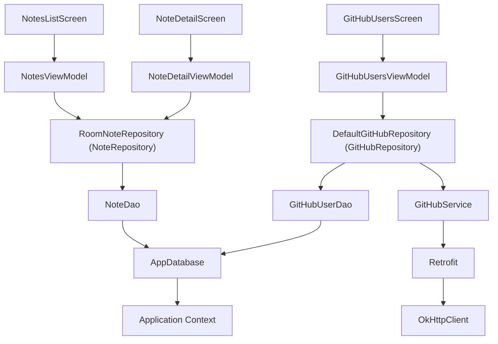

# Dependency Injection with Hilt — Practice Notes (Lecture 22)

> Complete record of theoretical answers, hands-on experiments, build/runtime error logs, scope tables, and architectural trade-offs for Questions 1–30.

---

## Section 1 — DI Fundamentals & Manual DI (Slides 2–8)

### Question 1 — `HardCar` vs `Car(engine: Engine)` (Hands-on)

**Implementation:**
- [`di-fundamentals/src/main/kotlin/com/example/difundamentals/Car.kt`](di-fundamentals/src/main/kotlin/com/example/difundamentals/Car.kt)
- [`di-fundamentals/src/test/kotlin/com/example/difundamentals/CarTest.kt`](di-fundamentals/src/test/kotlin/com/example/difundamentals/CarTest.kt)

**Observation (2 sentences):**
With `HardCar`, I could only test the default happy path (`"Driving"`) because `PetrolEngine()` is hard-coded inside the class, leaving no seam to force a broken-engine failure without modifying production code. With `Car(engine: Engine)`, injecting a `FakeEngine(working = false)` let me deterministically test both the broken-engine branch (`"Cannot start: engine broken"`) and the interaction count (`startCalls == 1`) in isolation.

---

### Question 2 — Three Ways a Class Obtains a Dependency (Theoretical, Slide 4)

Slide 4 identifies three ways a class can obtain an object it needs:

1. **Construct it directly** (e.g., `private val engine = PetrolEngine()` inside `Car`):
   - *Pros:* Zero boilerplate, immediately self-contained.
   - *Cons:* Hard-codes a concrete implementation; impossible to swap implementations (e.g., `ElectricEngine` or `FakeEngine` in tests); violates Dependency Inversion Principle; duplicates heavy resources if multiple classes construct their own `OkHttpClient` or DB.

2. **Grab it from somewhere** (global singletons, static factories, or Service Locator — e.g., `ApiInstance.service`, `DatabaseProvider.get(context)`, `ServiceLocator.get<Repo>()`):
   - *Pros:* Shares instances across classes; avoids passing parameters down deep call chains.
   - *Cons:* Hides dependencies (a class's constructor looks empty even though it secretly depends on network/database); global mutable state leaks between tests causing flaky/order-dependent tests; runtime crashes if the locator was not initialized first.

3. **Have it supplied (Dependency Injection)** (constructor injection `Car(private val engine: Engine)` or field/method injection):
   - *Pros:* Explicit, honest API (constructor declares everything the class needs); effortless substitution with fakes/stubs for fast JVM unit tests; decoupled from concrete implementations; enables centralized lifecycle/scope management.
   - *Cons:* Requires wiring code (manually via an `AppContainer` + factories, or via a DI framework like Hilt/Dagger).

**Key takeaway:** Only option 3 (having dependencies supplied) gives both testability and explicit dependency graphs, which is why manual DI and Hilt exist.

---

### Question 3 — `AppContainer` with Creation Counters (Hands-on)

**Implementation:**
- [`app/src/main/java/com/example/hiltnotes/di/AppContainer.kt`](app/src/main/java/com/example/hiltnotes/di/AppContainer.kt)
- [`app/src/main/java/com/example/hiltnotes/NotesApp.kt`](app/src/main/java/com/example/hiltnotes/NotesApp.kt)
- [`app/src/main/java/com/example/hiltnotes/MainActivity.kt`](app/src/main/java/com/example/hiltnotes/MainActivity.kt)

**Creation Counts Across 3 Screens (`notes` → `detail/1` → `github` → back to `notes`):**

| Object | Created Count (with `by lazy` in `AppContainer`) | Created Count (if instantiated per screen/factory without `by lazy`) | Should be created only once? |
|---|---|---|---|
| `OkHttpClient` | **1** | 3+ (every screen / repo call) | **Yes** — holds thread pools & HTTP connection pool |
| `Retrofit` | **1** | 3+ | **Yes** — expensive reflection / service proxy cache |
| `GitHubService` | **1** | 3+ | **Yes** — dynamic proxy created by Retrofit |
| `AppDatabase` | **1** | 3+ | **Yes** — Room SQLite connection pool; multiple instances risk lock contention & high memory |
| `NoteDao` | **1** | 3+ | **Yes** — cheap wrapper, safe to share from singleton DB |
| `RoomNoteRepository` | **1** | 3+ | **Yes** (or unscoped if stateless; single instance avoids redundant allocations) |
| `DefaultGitHubRepository` | **1** | 3+ | **Yes** — coordinates shared Retrofit + Room cache |

**Observation:**
Putting `AppContainer` on `NotesApp : Application` with `by lazy` ensures `created OkHttpClient (#1)`, `created Retrofit (#1)`, `created AppDatabase (#1)`, `created NoteDao (#1)`, and `created RoomNoteRepository (#1)` each print **once** for the entire app process lifetime, regardless of navigating between all three screens or rotating the device. Notice that `OkHttpClient`, `Retrofit`, and `GitHubService` are not even created until the user navigates to the `github` screen (lazy initialization).

---

### Question 4 — Rewiring the Notes App Manually on Branch `manual-di` (Hands-on)

**Branch:** `manual-di` (zero `ApiInstance.service` or `DatabaseProvider.get(context)` calls remain anywhere in the codebase; every dependency arrives via constructor parameters or `AppContainer`).

**Files Touched & Lines Added (excluding `NOTES.md`):**
- **Files touched:** **6** (`NotesViewModel.kt`, `NoteDetailViewModel.kt`, `GitHubUsersViewModel.kt`, `NotesScreens.kt`, `AppContainer.kt`, `MainActivity.kt`)
- **Lines added:** **350** lines added (32 lines replaced in `MainActivity.kt`)
- **Pure manual-DI boilerplate breakdown:**
  - `AppContainer.kt`: **92 lines**
  - Manual `ViewModelProvider.Factory` classes (3 factories × ~11 lines): **33 lines**
  - `NotesApp.kt` container bootstrap: **13 lines**
  - Total manual DI wiring overhead: **138 lines** (to be compared directly with the `hilt` branch in Question 21).

---

### Question 5 — Notes App Dependency Graph & Pains of Manual DI (Theoretical, Slide 7)

#### Dependency Graph (`A --> B` means "A needs B")



#### Concrete Pains from Slide 7 Shown in This Graph

1. **Factory boilerplate (`ViewModelProvider.Factory` everywhere):**
   - Every ViewModel (`NotesViewModel`, `NoteDetailViewModel`, `GitHubUsersViewModel`) requires its own custom `ViewModelProvider.Factory` plus a helper method on `AppContainer`. Adding a single new constructor parameter forces edits to the ViewModel, its Factory, `AppContainer`, and every call site.
   - **Hilt verdict:** **Removed entirely** — `@HiltViewModel` + `@Inject constructor` + `hiltViewModel()` generate all factory wiring automatically at compile time.

2. **Manual lifetime & scope management:**
   - Right now `AppContainer` only gives app-wide singletons (`by lazy`). If a dependency needs to live per-Activity, per-ViewModel, or per-Navigation-Flow (like a draft editor or user session), we must manually create sub-containers (`FlowContainer`), tie them to lifecycle callbacks, and remember to null them out on `onDestroy`/`onCleared` or risk memory leaks.
   - **Hilt verdict:** **Mostly removed (boilerplate gone), design decision moved to annotations** — Hilt provides built-in lifecycle-aware components (`SingletonComponent`, `ActivityRetainedComponent`, `ViewModelComponent`, `ActivityComponent`) and cleans them up automatically, though *you* still must choose the right scope.

3. **Construction-order & transitive dependency plumbing:**
   - `AppContainer` must manually wire the chain `Context -> AppDatabase -> NoteDao -> RoomNoteRepository` and `OkHttpClient -> Retrofit -> GitHubService -> DefaultGitHubRepository`, and pass `container` from `NotesApp` into `MainActivity` and down into `ManualNotesNavHost`.
   - **Hilt verdict:** **Removed for constructor-injected classes; moved to `@Module` for third-party / interface bindings** — Hilt resolves arbitrary transitive chains automatically, while creation recipes for third-party types (`OkHttpClient`, `Retrofit`, `Room`) move from `AppContainer` into `@Provides`/`@Binds` modules.

4. **Compile-time safety vs runtime errors (bonus pain):**
   - In manual DI, forgetting to initialize `container` or passing the wrong `Class<T>` to a `Factory` fails only at runtime (`UninitializedPropertyAccessException` / `IllegalArgumentException`).
   - **Hilt verdict:** **Removed (shifted to compile time)** — Dagger validates the entire dependency graph, scopes, and acyclicity during compilation.

---

## Section 2 — Setting Up Hilt (Slides 9–17)

### Question 6 — Hilt Gradle Plugin & `libs.versions.toml` Setup (`2.57.1`) (Hands-on)

**Files configured:**
- [`gradle/libs.versions.toml`](gradle/libs.versions.toml) (`hilt = "2.57.1"`, `hilt-android`, `hilt-compiler`, `hilt-android-testing`, plugin `com.google.dagger.hilt.android`)
- [`build.gradle.kts`](build.gradle.kts) (`alias(libs.plugins.hilt.android) apply false`)
- [`app/build.gradle.kts`](app/build.gradle.kts) (`alias(libs.plugins.ksp)`, `alias(libs.plugins.hilt.android)`, `implementation(libs.hilt.android)`, `ksp(libs.hilt.compiler)`)

**Intentional Mistake 1 — Hilt Gradle plugin applied, `ksp(libs.hilt.compiler)` removed:**
```text
FAILURE: Build failed with an exception.

* What went wrong:
Execution failed for task ':app:hiltJavaCompileDebug'.
> The Hilt Android Gradle plugin is applied but no com.google.dagger:hilt-compiler
  dependency was found. Please add the following dependency to your build.gradle file:
    ksp "com.google.dagger:hilt-compiler:2.57.1"
```
*(Or if bytecode transformation runs without generated `Hilt_*` classes, `ClassNotFoundException` / unresolved `Hilt_NotesApp` / missing `ApplicationComponentManager`.)*

**Intentional Mistake 2 — `ksp(libs.hilt.compiler)` present, `alias(libs.plugins.hilt.android)` removed from `:app`:**
```text
error: [Hilt]
To use @HiltAndroidApp / @AndroidEntryPoint without the Hilt Gradle plugin,
the class must extend the generated Hilt_<ClassName> class directly.
Otherwise apply the 'com.google.dagger.hilt.android' Gradle plugin so bytecode
transformation rewrites the superclass automatically.

Expected NotesApp to extend Hilt_NotesApp (or apply the Hilt Gradle plugin).
```
*(At runtime if not caught by validation, `java.lang.ClassCastException: NotesApp cannot be cast to dagger.hilt.internal.GeneratedComponentManagerHolder` because the Hilt Gradle plugin is what performs ASM bytecode rewriting of `NotesApp : Application` → `NotesApp : Hilt_NotesApp` and `MainActivity : ComponentActivity` → `MainActivity : Hilt_MainActivity`.)*
