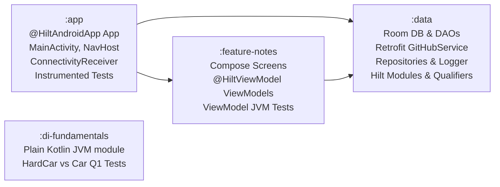
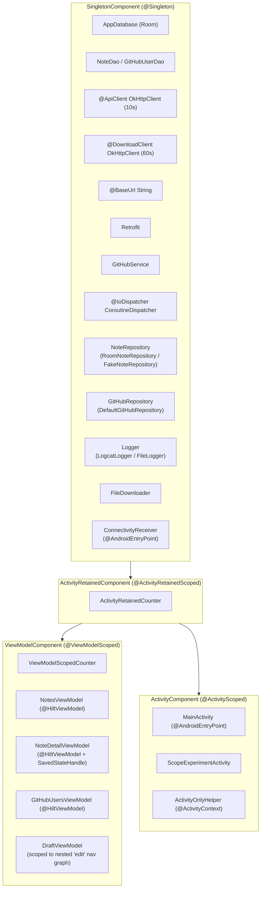
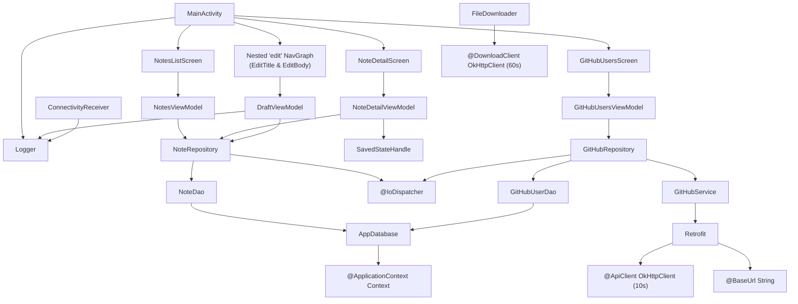

# Hilt Dependency Injection — Notes & GitHub Users Capstone (Lecture 22)

A multi-module Android application built with **Kotlin**, **Jetpack Compose**, **Room**, **Retrofit/OkHttp**, **Navigation Compose**, and **Dagger Hilt `2.57.1`**, covering all **30 practice questions** from Lecture 22 (from `HardCar` vs `Car` manual DI through `@HiltViewModel`, `@TestInstallIn`, `MockWebServer`, and Compose UI tests).

Detailed answers, error logs, scope tables, and manual-DI vs Hilt comparisons for Questions 1–30 are documented in [`NOTES.md`](NOTES.md).

---

## Architecture & Module Structure



---

## Hilt Component & Scope Diagram



---

## Dependency Graph (`needs` arrows)



---

## Hilt Modules & Qualifiers

| Module | Installed In | Bindings | Test Replacement |
|---|---|---|---|
| `DatabaseModule` | `SingletonComponent` | `AppDatabase` (`@ApplicationContext`), `NoteDao`, `GitHubUserDao` | `TestDatabaseModule` (in-memory Room) |
| `NetworkModule` | `SingletonComponent` | `@ApiClient OkHttpClient` (10s), `@DownloadClient OkHttpClient` (60s), `Retrofit`, `GitHubService` | `TestNetworkModule` (`MockWebServer`) |
| `DispatcherModule` / `BaseUrlModule` | `SingletonComponent` | `@IoDispatcher`, `@MainDispatcher`, `@BaseUrl` | Direct constructor injection in JVM tests |
| `RepositoryModule` | `SingletonComponent` | `@Binds GitHubRepository`, `NoteRepository` (real Room or `FakeNoteRepository` via `-PuseFakeRepo=true`) | Fake interfaces in JVM tests |
| `LoggingModule` | `SingletonComponent` | `@Binds Logger` (`LogcatLogger` / 1-line swap to `FileLogger`) | `RecordingLogger` in JVM tests |

---

## Test Suite Summary (17 Tests Total)

### Fast Pure-JVM Unit Tests (`./gradlew test`) — 13 Tests
1. `di-fundamentals` / `CarTest` (3 tests): `HardCar` vs `Car(FakeEngine)`
2. `data` / `NoteRepositoryDispatcherTest` (1 test): `RoomNoteRepository` with `StandardTestDispatcher`
3. `data` / `DefaultGitHubRepositoryTest` (2 tests): remote fetch + Room DAO caching
4. `data` / `GitHubServiceMockWebServerTest` (1 test): Retrofit + Gson payload parsing via `MockWebServer`
5. `feature-notes` / `NotesViewModelTest` (2 tests): add/blank-title guard/delete flows
6. `feature-notes` / `NoteDetailViewModelTest` (1 test): `SavedStateHandle(mapOf("noteId" to 7L))`
7. `feature-notes` / `GitHubUsersViewModelTest` (2 tests): success & network error handling
8. `feature-notes` / `DraftViewModelTest` (1 test): multi-step draft save & logger interaction

### Hilt Instrumented Tests (`./gradlew :app:connectedDebugAndroidTest`) — 4 Tests
1. `HiltInjectionSmokeTest` (1 test): verifies `HiltTestRunner`, `HiltAndroidRule`, and `hiltRule.inject()`
2. `NotesUiTest` (2 tests): Compose UI note creation + consecutive-run isolation via `TestDatabaseModule`
3. `GitHubUsersMockWebServerTest` (1 test): full integration of `TestNetworkModule` (`MockWebServer`) → `GitHubRepository` → `TestDatabaseModule` (in-memory Room)

**Total: 17 automated tests (13 JVM + 4 Hilt instrumented).**

---

## How to Build & Run in Android Studio / CLI

```bash
# 1. Run all pure-JVM unit tests (no emulator needed)
./gradlew test

# 2. Install real Room-backed debug app
./gradlew :app:installDebug

# 3. Install fake sample-data debug build (Question 23)
./gradlew :app:installDebug -PuseFakeRepo=true

# 4. Run Hilt instrumented & Compose UI tests on an emulator/device
./gradlew :app:connectedDebugAndroidTest
```

## Git Branches & Commit History
- `manual-di`: Pure manual DI snapshot from Question 4 (`AppContainer` + manual `ViewModelProvider.Factory` classes).
- `hilt`: Hilt migration snapshot from Question 21 (`git diff --stat manual-di..hilt`).
- `main`: Full 30-commit progression (`q01:` through `q30:`) culminating in this Capstone.
